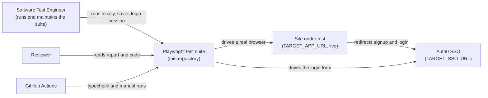
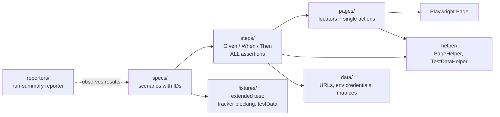

# Architecture

Design and decisions for the automation in `e2e-tests/`. Setup and commands are in [`README.md`](../README.md) and
[`ONBOARDING.md`](ONBOARDING.md); operational procedures are in [`RUNBOOKS.md`](RUNBOOKS.md). Diagrams are Mermaid
(rendered by GitHub).

## 1. C4 diagrams

### Level 1: system context



There is no test environment: the suite drives the live site, so site availability and bot protection (captcha) are
part of the system under test's behaviour.

### Level 2: containers

```mermaid
flowchart TB
  subgraph local["Developer machine"]
    npm["npm scripts<br/>package.json"]
    env[".env and .auth/user.json<br/>(git-ignored)"]
  end
  subgraph repo["Repository"]
    cfg["playwright.config.ts"]
    code["e2e-tests/<br/>specs, steps, pages, data,<br/>fixtures, helper, reporters"]
    wf[".github/workflows/playwright.yml<br/>.github/scripts/"]
  end
  pw["Playwright runner<br/>chromium, firefox, webkit"]
  out["playwright-report/, test-results/<br/>HTML, JUnit, run-summary.json"]
  ci["GitHub Actions runner<br/>(ubuntu-24.04)"]

  npm --> pw
  env --> pw
  cfg --> pw
  code --> pw
  wf --> ci --> pw
  pw --> out
  ci -->|"artifacts, job summary"| out
```



### Level 3: components (inside `e2e-tests/`)



### Layer rules

| Layer | Owns | Must not |
| --- | --- | --- |
| `specs/` | Readable scenarios: titles with IDs (`AF-LOGIN-01`…), calls to steps | Hold locators, `expect`, or raw Playwright actions |
| `steps/` | Given / When / Then methods, **all assertions**, skip decisions | Know selectors |
| `pages/` | Role/label-based locators and one-action methods, navigation resilience | Assert test outcomes |
| `data/` | Environment URLs, credentials read from `process.env`, invalid-input tables | Contain secrets |
| `fixtures/` | `test` with tracker blocking and the `testData` registry | |
| `helper/` | `PageHelper` (redirect wait, manual-captcha switch), `TestDataHelper` (unique emails) | |

## 2. What runs where

| Test | Headless / CI | Manual-assist (`test:login:manual`) |
| --- | --- | --- |
| `AF-LOGIN-01`, `02`, `06`, `AF-SIGNUP-01`, `02`, `03`×4, `04`, `05` | Runs | Runs |
| `AF-LOGIN-03` | Runs only if `.auth/user.json` exists; otherwise skipped | Same |
| `AF-LOGIN-04`×2, `AF-LOGIN-05` | Runs unless a captcha appears, then skipped (`05` also needs credentials) | Runs; waits for a person at the captcha |
| `AF-SIGNUP-06` | Opt-in; skipped if captcha | Opt-in; waits for a person |

CI therefore verifies less than a local manual run. The run summary reporter makes the gap visible on every run.

## 3. Architecture decision records

Each record: context, decision, consequences. Status is **Accepted** unless noted.

### ADR-001: Assertions live in the steps layer

- **Context:** Page objects that assert become single-purpose and hard to reuse; specs that assert hide the scenario.
- **Decision:** `pages/` have no assertions; `steps/` (`ThenI…`) hold all of them; `specs/` only call steps.
- **Consequences:** A UI change is fixed in one page object, a behaviour change in one step. Reviewers can enforce the
  rule with a grep. More files than a flat spec.

### ADR-002: Role/label locators, no XPath

- **Context:** Auth0 markup changes without notice; positional CSS and XPath break first.
- **Decision:** `getByRole` with accessible name, then label, then a stable id. Auth0 pre-renders every error message and
  shows only the active ones, so error locators filter to `:visible`. The single `force` click (custom terms checkbox)
  is commented in `signup.page.ts` and retried until the box is really checked.
- **Consequences:** Locators double as an accessibility smoke check. Tied to accessible names, so a copy change can break them.

### ADR-003: No fixed sleeps; resilient navigation

- **Context:** Navigation to the live site stalls intermittently (SSO redirect, third-party stylesheet).
- **Decision:** Web-first assertions and URL waits only. `GivenINavigateTo…Page` waits for `domcontentloaded`, the form
  and all stylesheets, and retries up to 3 times. Ad/tracker hosts are blocked in the shared fixture.
- **Consequences:** Flakiness is reduced, not removed. Retried navigation can mask a slow site, so a flaky test is
  surfaced in the run summary instead of hidden.

### ADR-004: Never solve or bypass a captcha in code

- **Context:** Repeated automated logins and signups trigger Auth0's captcha. Bypassing it would defeat a security control.
- **Decision:** Three explicit outcomes, so a result is never misleading:

  ```
  fresh login reaches the password step ──▶ the test really runs (pass / fail)
  captcha shown, headless or CI         ──▶ SKIPPED with a reason     (unverified gap, not a pass)
  captcha shown, MANUAL_CAPTCHA=1 + headed ─▶ a person solves it; the test continues and really runs
  ```

- **Consequences:** CI has permanent skips until the tenant owner provides an allow-listed test account or disables bot
  protection for one. Manual-assist mode is local only.

### ADR-005: Valid login reuses a saved session

- **Context:** `AF-LOGIN-03` needs a logged-in state without a fresh login (which meets the captcha).
- **Decision:** A person logs in once with `npm run auth:save` → `.auth/user.json` (git-ignored, live tokens). CI
  receives it as a gzip + base64 secret (`AUTH_SESSION_B64`; plain base64 is ~54 KB, over GitHub's 48 KB secret limit).
- **Consequences:** The session expires and is refreshed by hand. An expired session **fails** with a message saying so
  (not a skip), so a real regression cannot hide. It was verified to fail with an empty session, so it cannot pass vacuously.

### ADR-006: Skips are reported, not counted as passes

- **Context:** A green run with half the tests skipped is misleading.
- **Decision:** `reporters/run-summary.reporter.ts` lists skipped tests with reasons, known issues, and tests that passed
  only on retry; writes `test-results/run-summary.json`. `MAX_SKIPPED=<n>` turns the skip count into a gate (the
  workflow exposes it as the `max_skipped` input).
- **Consequences:** The summary must be read; the gate is opt-in because CI skips are currently expected.

### ADR-007: Test data creates nothing by default

- **Context:** The target is production; test accounts are real accounts.
- **Decision:** Negative signup cases stop before a valid submit. The one live signup (`AF-SIGNUP-06`) is opt-in
  (`RUN_LIVE_SIGNUP=1` + `SIGNUP_BASE_EMAIL`), uses a plus-addressed email, and records a `test-data-created` annotation.
  Credentials come only from the environment.
- **Consequences:** Created accounts must be cleaned up by hand (see the runbook).

### ADR-008: Tests run on demand, not on every push

- **Context:** Each run hits the live site; frequent runs raise captcha rates.
- **Decision:** Typecheck runs on every push and pull request. Tests run on `workflow_dispatch` only; there is no scheduled run, which also keeps a public repository from hitting the live site unattended.
  The runner is pinned to `ubuntu-24.04` because `ubuntu-latest` moves to a release this Playwright version does not support.
  The `tests` job runs in the official `mcr.microsoft.com/playwright:v<version>-noble` container (browsers and system
  dependencies preinstalled) because `playwright install --with-deps` hung on the runner's apt mirror; keep the image tag equal to
  the `@playwright/test` version.
- **Consequences:** A broken test is found at the next manual run, not on the commit that broke it.

### ADR-009: Report publishing is a redacted single file; Pages is off

- **Context:** The repo is private; GitHub Pages sites are public and private-repo Pages needs a paid plan. Traces,
  screenshots and videos can hold typed credentials and the account email.
- **Decision:** Every run uploads (a) the full report with traces, 14 days, and (b) a single redacted
  `playwright-report.html` (attachments removed, secret values replaced; no file at all if a secret survives) linked from
  the run's Summary page. The `publish-report` job (GitHub Pages) runs only when the variable `PUBLISH_REPORT` is `true`.
- **Consequences:** The report is one click away on a private repo. Enabling Pages needs a plan change and a decision
  from the repo owner.

### ADR-010: GitHub Actions is the only CI

- **Context:** A `Jenkinsfile` exists in some local copies but is not tracked.
- **Decision:** CI is GitHub Actions only. The `Jenkinsfile` is not part of the repository.
- **Consequences:** One pipeline to maintain.

## 4. Configuration

`playwright.config.ts`: chromium, firefox and webkit projects; 120 s test timeout, 15 s expect/action, 30 s navigation;
trace, screenshot and video kept on failure only; when `CI=true`: 1 retry, 2 workers, `forbidOnly`, and a JUnit report.

## 5. Known limits and what would change them

- It runs against the **live production site**; there is no test environment.
- Saved sessions expire and must be refreshed by hand.
- The durable fix for captcha skips is an allow-listed test account or a tenant with bot protection off, requested from
  the tenant owner. Then the saved session and manual-assist mode become unnecessary.
- `CommonSteps.GivenIAmLoggedInAs` performs a fresh login and is currently unused. Post-login specs should reuse the
  saved session (`test.use({ storageState })`), as `login-session.spec.ts` does.
- Prepared and verified on macOS only.
